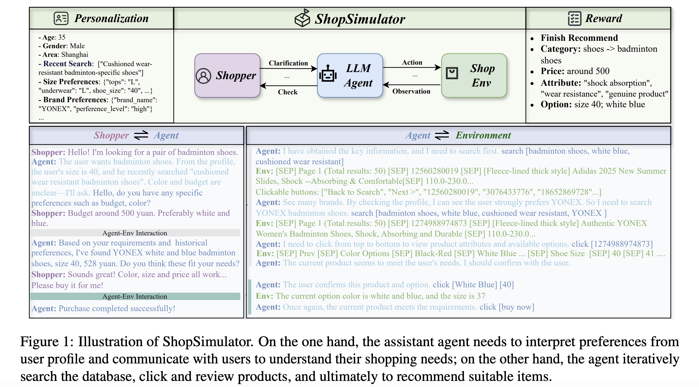
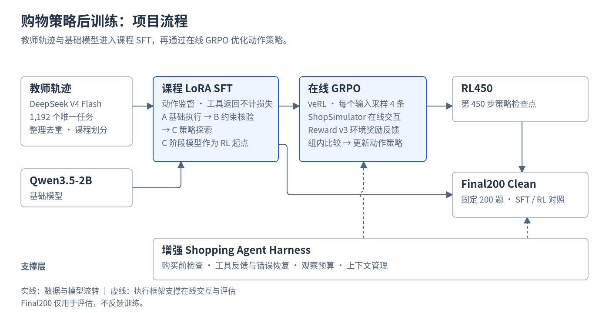
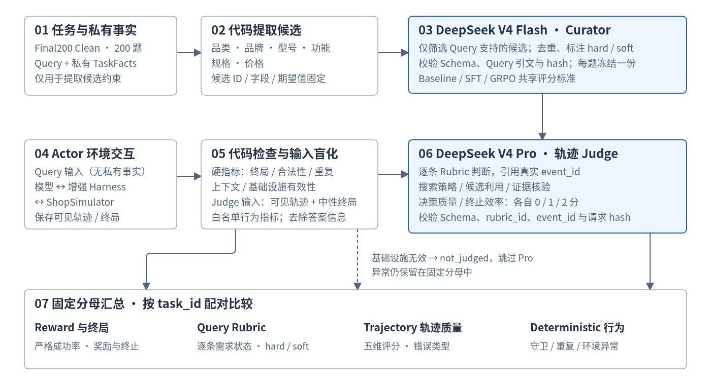

# Shopping Agent RL

[](pyproject.toml) [](#项目流程) [](pyproject.toml) [](#任务与环境) [](#实验结果) [](LICENSE)

**中文购物任务中的小模型策略后训练与评估**

Qwen3.5-2B · 三阶段课程 SFT · 在线 GRPO · Final200 Clean

通过教师轨迹建立购物行为，再利用环境奖励优化多轮决策。配合增强执行框架，在显式获取商品详情的评估设置下，课程 SFT 严格成功率为 **65%**，RL450 为 **69%**。

[任务与环境](#任务与环境) · [训练方法](#项目流程) · [执行框架](#shopping-agent-harness执行框架增强) · [实验结果](#实验结果) · [快速开始](#快速开始) · [目录导航](#目录导航)

## 任务与环境

### ShopSimulator 是什么？

[ShopSimulator](https://github.com/ShopAgent-Team/ShopSimulator) 是一个用于评估多轮购物决策的中文模拟购物环境。本项目的每个任务给出一段用户需求，其中可能包含商品类别、预算、品牌、型号、核心功能，以及颜色、尺寸、容量、套餐等具体规格。

模型需要通过工具与环境交互，将需求落实为一次满足约束的模拟购买：

1. **搜索商品**：将需求转成搜索条件，找到候选商品。
2. **查看与比较**：打开商品页面，显式获取描述、参数和可选规格。
3. **核对约束**：逐项检查价格、功能和规格，选择符合要求的商品变体。
4. **完成决策**：证据充分时购买；条件不满足或无法继续时，合理结束任务。

这类任务同时考察需求理解、工具调用、多轮上下文管理、约束核验和终止决策。常见失败包括遗漏规格、调用当前页不存在的按钮、重复搜索，以及在证据不足时购买；本项目通过课程 SFT、在线 GRPO 和执行框架增强改善这些问题。

项目已在 [environments/ShopSimulator/](environments/ShopSimulator/) 内置固定版本的环境源码和商品数据，无需另行克隆环境仓库；安装与商品索引构建见 [快速开始](#快速开始)。当前评估使用固定的 Final200 Clean 需求清单，按最终购买是否满足任务约束统计严格成功率。




## 项目流程

主线是 **数据构建 → 课程 SFT → 在线 GRPO → 逐任务评估**，购物执行框架为训练和评估提供工具交互支持。



教师轨迹与基础模型进入课程 SFT，再通过在线 GRPO 优化策略；增强 Harness 支撑在线交互与评估。

<table width="100%">
  <thead>
    <tr>
      <th width="200" align="center">环节</th>
      <th width="1000" align="left">本项目的工作</th>
    </tr>
  </thead>
  <tbody>
    <tr>
      <td align="center">数据</td>
      <td align="left">教师轨迹整理、去重、课程划分和任务集隔离</td>
    </tr>
    <tr>
      <td align="center">SFT</td>
      <td align="left">动作监督 LoRA 微调，按 A/B/C 三阶段累计训练</td>
    </tr>
    <tr>
      <td align="center">GRPO</td>
      <td align="left">组内多轨迹采样，使用环境反馈更新策略</td>
    </tr>
    <tr>
      <td align="center">执行框架</td>
      <td align="left">环境会话、动作检查、错误反馈与上下文管理</td>
    </tr>
    <tr>
      <td align="center">评估</td>
      <td align="left">固定任务、保存终局证据、配对比较成功与失败</td>
    </tr>
  </tbody>
</table>

### 训练数据如何组织？

使用 **DeepSeek V4 Flash** 教师轨迹构建训练数据：1,450 条候选去除 258 条重复后，保留 **1,192 个唯一任务对应的轨迹**，再按基础执行、约束核验与策略探索划分课程。

课程逐步扩展训练任务，同时保留前阶段内容。每阶段训练完成后合并 LoRA 参数，作为下一阶段的模型起点。

<table width="100%">
  <thead>
    <tr>
      <th width="110" align="center">阶段</th>
      <th width="490" align="left">课程范围</th>
      <th width="200" align="right">训练清单</th>
      <th width="200" align="right">验证清单</th>
      <th width="200" align="right">学习率</th>
    </tr>
  </thead>
  <tbody>
    <tr>
      <td align="center">A</td>
      <td align="left">基础执行</td>
      <td align="right">256</td>
      <td align="right">28</td>
      <td align="right">1e-4</td>
    </tr>
    <tr>
      <td align="center">B</td>
      <td align="left">基础执行 + 约束核验</td>
      <td align="right">799</td>
      <td align="right">88</td>
      <td align="right">7e-5</td>
    </tr>
    <tr>
      <td align="center">C</td>
      <td align="left">基础执行 + 约束核验 + 策略探索</td>
      <td align="right">1,073</td>
      <td align="right">119</td>
      <td align="right">5e-5</td>
    </tr>
  </tbody>
</table>

各阶段为累计清单，不能把三行相加作为独立任务数。C 阶段预处理后的实际训练/验证样本数为 1,069/118。

SFT 使用动作监督：模型学习何时搜索、查看详情、选择规格及购买；工具返回文本不参与预测损失。历史 C 阶段采用 LoRA rank 16、alpha 32、BF16 和 24,576 token 最大序列长度。

### GRPO 如何优化策略？

以 C 阶段合并模型为起点，针对同一需求采样多条交互轨迹，在组内比较结果好坏，再更新动作策略。

<table width="100%">
  <thead>
    <tr>
      <th width="290" align="left">设置</th>
      <th width="910" align="left">本项目实验配置</th>
    </tr>
  </thead>
  <tbody>
    <tr>
      <td align="left">训练框架</td>
      <td align="left">veRL，vLLM 生成</td>
    </tr>
    <tr>
      <td align="left">训练方式</td>
      <td align="left">LoRA，四卡</td>
    </tr>
    <tr>
      <td align="left">每组采样数</td>
      <td align="left">4</td>
    </tr>
    <tr>
      <td align="left">训练采样</td>
      <td align="left">temperature 0.7，top_p 0.9</td>
    </tr>
    <tr>
      <td align="left">学习率</td>
      <td align="left">1e-6</td>
    </tr>
    <tr>
      <td align="left">LoRA</td>
      <td align="left">rank 16，alpha 32</td>
    </tr>
    <tr>
      <td align="left">策略裁剪</td>
      <td align="left">0.2</td>
    </tr>
    <tr>
      <td align="left">优势计算</td>
      <td align="left">GRPO 组内均值中心化，不按标准差归一化</td>
    </tr>
    <tr>
      <td align="left">KL 项</td>
      <td align="left">关闭</td>
    </tr>
    <tr>
      <td align="left">本页展示检查点</td>
      <td align="left">第 450 个优化步骤</td>
    </tr>
  </tbody>
</table>

训练信号来自 ShopSimulator 的确定性终局奖励，不需要额外的 LLM Judge 奖励模型。

### 评估如何判定成功？

评估保留固定的 200 道任务及原始需求。模型主动调用工具获取详情，单条轨迹最多执行 35 步。每道题保存工具交互记录、环境终局和运行指标，便于定位失败原因。

主指标采用原 Reward v3 的严格成功定义：完整购买终局满足 `done`、`over`、`purchase`，奖励类型为 `gold_purchase`，且 `reward_valid=true`、无基础设施无效标记。

成功率、动作守卫拒绝次数、错误购买和环境异常分别统计。失败和异常留在分母中

## Shopping Agent Harness：执行框架增强

后训练优化模型的动作策略，执行框架负责把动作接入环境、返回有效反馈并管理交互状态。我们围绕购物任务中的预算违规、规格遗漏、页面操作错误和长轨迹信息积累，组织了以下增强：

<table width="100%">
  <thead>
    <tr>
      <th width="270" align="left">组件</th>
      <th width="580" align="left">实现内容</th>
      <th width="350" align="left">对应问题</th>
    </tr>
  </thead>
  <tbody>
    <tr>
      <td align="left">A · 核验提示</td>
      <td align="left">引导模型按搜索、证据收集、规格选择、购买核验组织动作</td>
      <td align="left">遗漏需求或缺少购买前核验</td>
    </tr>
    <tr>
      <td align="left">B · 购买前检查</td>
      <td align="left">对未选完规格、价格未知、明确数字预算违规的购买请求进行拦截</td>
      <td align="left">在执行条件不足时过早购买</td>
    </tr>
    <tr>
      <td align="left">C · 工具接口与错误恢复</td>
      <td align="left">保留精确规格标签，仅在空白差异可唯一匹配时修正参数，并提供当前页面的恢复反馈</td>
      <td align="left">标签匹配失败、无效点击后无法继续</td>
    </tr>
    <tr>
      <td align="left">D · 观察预算</td>
      <td align="left">将增强配置的观察预算设为 8,192 token，保留更多搜索结果与商品标题信息</td>
      <td align="left">搜索反馈被过早截断</td>
    </tr>
    <tr>
      <td align="left">E · 上下文管理</td>
      <td align="left">按完整交互组裁剪历史，同步维护 token 与训练掩码，并为生成预留空间</td>
      <td align="left">长轨迹超出上下文预算</td>
    </tr>
    <tr>
      <td align="left">F · 商品数据与索引一致性</td>
      <td align="left">配对维护核验后的商品字段与搜索索引</td>
      <td align="left">页面证据、商品数据与检索结果不一致</td>
    </tr>
    <tr>
      <td align="left">G · 购买与候选判定</td>
      <td align="left">根据需求证据复核购买约束和候选资格，保留原奖励供严格成功统计</td>
      <td align="left">环境判定与需求证据难以对应</td>
    </tr>
  </tbody>
</table>

动作被拦截后，框架返回反馈，由模型决定下一步；预算与规格检查不替代模型对全部语义需求的判断。

### 组件消融

固定 C 阶段 SFT 模型、200 道任务、贪心解码及显式详情获取方式，逐项移除组件，观察执行结果变化。S 为增强配置参考组。

<table width="100%">
  <thead>
    <tr>
      <th width="600" align="left">配置</th>
      <th width="200" align="right">严格成功数</th>
      <th width="160" align="right">成功率</th>
      <th width="240" align="right">相对 S 变化</th>
    </tr>
  </thead>
  <tbody>
    <tr>
      <td align="left">S：增强框架</td>
      <td align="right">130/200</td>
      <td align="right"><strong>65.0%</strong></td>
      <td align="right">—</td>
    </tr>
    <tr>
      <td align="left">移除 A：核验提示</td>
      <td align="right">126/200</td>
      <td align="right">63.0%</td>
      <td align="right">−2.0 个百分点</td>
    </tr>
    <tr>
      <td align="left">移除 B：额外购买检查</td>
      <td align="right">123/200</td>
      <td align="right">61.5%</td>
      <td align="right">−3.5 个百分点</td>
    </tr>
    <tr>
      <td align="left">移除 C：接口与恢复增强</td>
      <td align="right">120/200</td>
      <td align="right">60.0%</td>
      <td align="right">−5.0 个百分点</td>
    </tr>
    <tr>
      <td align="left">移除 D：观察预算增强</td>
      <td align="right">124/200</td>
      <td align="right">62.0%</td>
      <td align="right">−3.0 个百分点</td>
    </tr>
    <tr>
      <td align="left">移除 E：上下文管理增强</td>
      <td align="right">131/200</td>
      <td align="right">65.5%</td>
      <td align="right">+0.5 个百分点</td>
    </tr>
    <tr>
      <td align="left">移除 F：商品数据与索引修复¹</td>
      <td align="right">128/200</td>
      <td align="right">64.0%</td>
      <td align="right">−1.0 个百分点</td>
    </tr>
    <tr>
      <td align="left">移除 G：购买与候选判定增强</td>
      <td align="right">131/200</td>
      <td align="right">65.5%</td>
      <td align="right">+0.5 个百分点</td>
    </tr>
  </tbody>
</table>

购买检查的作用在失败类型上也有体现：移除 B 后，错误购买从 **10 题增加到 21 题**，重复循环从 13 题降到 8 题，呈现购买约束与继续探索之间的取舍。当前实验中，移除 E、G 未降低成功率，尚未观察到这两项的成功率净收益。

**实验说明**：以上为单次逐项移除实验，组件差值不可相加。A/C/D/E 组包含搜索串行化修复，S/B/G 组未包含，相关差异存在运行版本混杂。¹ F 首次运行有两题环境异常；表中结果保留其余 198 条原轨迹，仅替换两题修复后重跑结果。整理后的组件代码未重新运行整套模型评测。

## 完整评估流水线

评估由 **代码硬检查 → 双 Judge → 固定分母汇总** 组成。代码负责可确定的执行指标，两个 Judge 分别整理评分标准、评价交互轨迹。



> **结果口径**：下文的 **65% / 69%** 是 Reward 严格成功率。图中展示完整评估框架，不代表这组实验已完成双 Judge 评分。Reward、需求满足、轨迹质量和执行指标分开报告，不合成总分。

### 两个 Judge 如何分工？

**1. DeepSeek V4 Flash：整理并冻结 Rubric**

- 代码根据每题的 Query 和私有 TaskFacts，提取品类、品牌、型号、功能、规格及价格候选。
- Flash 从候选中筛选用户真正要求的约束、去重，并标注 hard / soft；不能新增字段或期望值。
- 每题 Rubric 只冻结一次，由 Baseline、SFT 和 GRPO 共用。这里的 Rubric 指逐任务评分标准。

**2. DeepSeek V4 Pro：评价 Actor 轨迹**

- 输入包括用户 Query、冻结 Rubric、Actor 实际可见的完整轨迹、中性终局状态和白名单代码指标。
- 逐条判断需求是否满足，并对 **搜索策略、候选利用、证据核验、决策质量、终止效率** 分别给出 0 / 1 / 2 分。
- 每项判断引用真实的 `event_id`，便于回查轨迹证据。

**输入隔离**：Pro 不接收 Reward 分数、Gold 商品私有字段、raw Observation、成功标签或其他模型结果，避免利用答案倒推轨迹质量。

### 一道任务如何经过评估？

以 Final-200 的 `task_id=8187` 为例，用户需求为：

> 一对卡通“永结同心”款的高档酒红色木梳，礼盒、陪嫁，20 元左右。

1. **提取候选**：代码生成 7 条候选，Flash 整理为 5 条冻结 Rubric。
2. **执行任务**：SFT Actor 用 10 步完成搜索、详情核验、规格选择和购买。
3. **评价轨迹**：Pro 按五个维度给出 **2 / 1 / 1 / 2 / 2**，并逐项引用轨迹中的 `event_id`。

### 四个独立结果面板

<table width="100%">
  <thead>
    <tr>
      <th width="360" align="left">面板</th>
      <th width="840" align="left">报告内容</th>
    </tr>
  </thead>
  <tbody>
    <tr>
      <td align="left">Reward 与终局</td>
      <td align="left">Environment Reward、严格成功率及终止状态</td>
    </tr>
    <tr>
      <td align="left">Query Rubric</td>
      <td align="left">hard / soft 需求满足情况，以及与 Reward 判定的分歧</td>
    </tr>
    <tr>
      <td align="left">Trajectory 轨迹质量</td>
      <td align="left">Pro Judge 五维评分分布与错误类型</td>
    </tr>
    <tr>
      <td align="left">Deterministic 执行指标</td>
      <td align="left">步数、工具调用、Guard、重复、上下文和基础设施指标</td>
    </tr>
  </tbody>
</table>

所有面板保留 Final-200 Clean 的固定分母，缺失、报错和 `not_judged` 任务不从分母中删除。

相关口径见 [评估说明](docs/evaluation.md)，任务集与数据组织见 [数据说明](docs/data.md)。

## 实验结果

### Final200 结果与验证集试跑效率

Final200 的课程 SFT（C）和 RL450 两组均采用 temperature=0、top_p=1，每题一次，最多 35 个执行步骤，商品详情通过显式工具获取。GPT 两组的 Final200 尚未评测；效率试跑使用相同的增强框架与提示词，GPT 使用服务默认生成设置。

<table width="100%">
  <thead>
    <tr>
      <th align="left">模型与执行配置</th>
      <th align="right">Final200 严格成功数</th>
      <th align="right">Final200 严格成功率</th>
      <th align="right">平均生成 tokens*</th>
      <th align="right">平均轨迹耗时*</th>
      <th align="right">动作守卫拒绝次数</th>
      <th align="right">涉及拒绝的任务数</th>
      <th align="right">环境异常</th>
    </tr>
  </thead>
  <tbody>
    <tr>
      <td align="left">课程 SFT（C）+ 增强框架</td>
      <td align="right">130/200</td>
      <td align="right">65.0%</td>
      <td align="right">—</td>
      <td align="right">—</td>
      <td align="right">94</td>
      <td align="right">56</td>
      <td align="right">0</td>
    </tr>
    <tr>
      <td align="left">RL450 + 增强框架（含搜索并发修复）</td>
      <td align="right">138/200</td>
      <td align="right">69.0%</td>
      <td align="right">589.96</td>
      <td align="right">19.63 秒</td>
      <td align="right">65</td>
      <td align="right">39</td>
      <td align="right">0</td>
    </tr>
    <tr>
      <td align="left">GPT-6.1-Sol + 增强框架</td>
      <td align="right">138/200</td>
      <td align="right">69.0%</td>
      <td align="right">222.09</td>
      <td align="right">57.74 秒</td>
      <td align="right">—</td>
      <td align="right">—</td>
      <td align="right">—</td>
    </tr>
    <tr>
      <td align="left">GPT-6-Astra + 增强框架</td>
      <td align="right">138/200</td>
      <td align="right">69.0%</td>
      <td align="right">183.98</td>
      <td align="right">52.32 秒</td>
      <td align="right">—</td>
      <td align="right">—</td>
      <td align="right">—</td>
    </tr>
  </tbody>
</table>

- Final200 中，RL450 相比课程 SFT（C）的严格成功率高 **4 个百分点**；逐题比较新增成功 17 题、丢失成功 9 题，净增加 8 题。
- 动作守卫拒绝次数减少 **30.9%**。这一指标统计执行前被规则拦截的动作，不能解释为错误购买率下降。
- 两组错误购买均为 10 题。


## 环境与依赖

- Linux、NVIDIA GPU 与兼容的 CUDA 驱动。
- 主训练环境使用 Python 3.12，ShopSimulator 使用独立的 Python 3.10 环境。
- 使用 `uv` 管理依赖；项目依赖与锁定版本记录在 `pyproject.toml` 和 `uv.lock`。
- 已完成的 C 阶段 SFT 和 GRPO 使用四卡；这不代表四卡是所有配置的最低要求。

当前训练数据、课程清单、评估任务和商品压缩包已纳入目录，索引由安装脚本生成。模型权重单独发布，见 [模型说明](docs/models.md)。

## 快速开始

以下命令以整理后的源码根目录为工作目录。安装脚本需要 ShopSimulator 源码及配套商品数据已就位；本页提供已核实的脚本入口，历史结果复现还需匹配冻结配置与数据。

### 1. 安装依赖并准备环境

```bash
bash scripts/setup.sh
```

脚本安装训练依赖，创建模拟器环境，校验商品数据并构建搜索索引。

### 2. 启动模拟器

在单独的终端中保持服务运行：

```bash
bash scripts/start_environment.sh
```

### 3. 查看课程 SFT 参数

```bash
python scripts/run_sft_curriculum.py --help
```

准备好模型与数据后，可先打印课程命令：

```bash
bash scripts/sft_curriculum.sh \
  --base-model Qwen/Qwen3.5-2B \
  --source data/sft_pure_v4/all.jsonl \
  --manifest data/sft_curriculum/manifest.json \
  --output-root outputs/models/sft-curriculum \
  --dry-run
```

`--dry-run` 读取并核验课程清单，打印各阶段训练与合并命令，不执行训练。历史四卡 C 阶段还有专门的分布式启动配置。

### 4. 查看 GRPO 参数

```bash
python scripts/train_grpo.py --help
```

指定 C 阶段模型、训练集和验证集后，可检查最终启动命令：

```bash
bash scripts/grpo.sh \
  --model outputs/models/sft-curriculum/stage-c/merged \
  --train-data data/grpo/train.parquet \
  --val-data data/grpo/validation.parquet \
  --output outputs/models/grpo \
  --dry-run \
  -- trainer.n_gpus_per_node=4
```

模型、数据和环境清单必须存在。完整评估入口将随冻结配置一起整理；当前默认训练脚本不直接等同于实验表的复现协议。

## 奖励设计

奖励采用环境 Reward v3：对类目与预算设置硬约束，对品牌、型号、功能、规格等需求进行匹配，并区分完整目标购买、部分匹配与失败。训练奖励和严格成功率分开统计，奖励增加不直接等于任务成功。

## 目录导航

以下为源码模块布局；当前数据随仓库提供，模型权重与完整日志单独管理。

```text
configs/                         GRPO、AgentLoop 与工具配置
scripts/
  prepare_sft_curriculum.py       生成课程清单
  run_sft_curriculum.py           调度 A/B/C 阶段
  train_lora_sft.py               LoRA SFT
  train_grpo.py                  GRPO 入口
src/shopping_grpo/
  collection/                    教师轨迹采集与处理
  environment/                   环境会话、工具、观察与上下文
  training/sft/                  样本构建与损失标签
  training/grpo/                 多轮采样与训练适配
  evaluation/                    轨迹与指标处理
environments/ShopSimulator/       购物模拟环境
tests/                           核心模块测试
pyproject.toml                    项目依赖
uv.lock                           依赖锁文件
```

## 常用训练配置

<table width="100%">
  <thead>
    <tr>
      <th width="480" align="left">参数</th>
      <th width="460" align="left">作用</th>
      <th width="260" align="center">本项目设置</th>
    </tr>
  </thead>
  <tbody>
    <tr>
      <td align="left"><code>--curriculum-stage</code></td>
      <td align="left">单阶段 SFT 课程选择</td>
      <td align="center">a / b / c</td>
    </tr>
    <tr>
      <td align="left"><code>--max-length</code></td>
      <td align="left">SFT 最大序列长度</td>
      <td align="center">24,576</td>
    </tr>
    <tr>
      <td align="left"><code>--lora-r</code> / <code>--lora-alpha</code></td>
      <td align="left">SFT 低秩适配参数</td>
      <td align="center">16 / 32</td>
    </tr>
    <tr>
      <td align="left"><code>actor_rollout_ref.rollout.n</code></td>
      <td align="left">GRPO 每个输入的采样数</td>
      <td align="center">4</td>
    </tr>
    <tr>
      <td align="left"><code>actor_rollout_ref.actor.optim.lr</code></td>
      <td align="left">RL 学习率</td>
      <td align="center">1e-6</td>
    </tr>
    <tr>
      <td align="left"><code>trainer.n_gpus_per_node</code></td>
      <td align="left">单节点使用的 GPU 数</td>
      <td align="center">4</td>
    </tr>
  </tbody>
</table>

训练配置以对应实验记录为准，启动参数可以覆盖默认配置。

## 后续工作

- 统一搜索实现与执行框架版本，开展完全一致条件下的 SFT/RL 对照。
- 增加独立评估任务与重复训练，检查策略的稳定性和泛化表现。
- 分析循环、约束遗漏和提前结束等失败，改进轨迹数据与长程奖励信号。
- 补充同协议大模型对照，以及推理延迟和每次成功任务的成本测量。

当前结果对应固定 200 题和单次训练路线。需求不完整的 14671、2717 保留在任务集与分母中，单列待复核。

## 环境与致谢

购物任务依托 **ShopSimulator**。基础模型使用 **Qwen3.5-2B**，教师数据来自 **DeepSeek V4 Flash**，训练技术栈使用 **PyTorch、Transformers、PEFT、veRL 和 vLLM**。

本项目代码采用 [MIT License](LICENSE)。Qwen3.5-2B 基础模型采用 Apache-2.0；第三方组件与数据说明见 [许可说明](THIRD_PARTY_NOTICES.md)。

## 模型下载

<table width="100%">
  <thead>
    <tr>
      <th width="240" align="left">模型</th>
      <th width="960" align="left">Hugging Face 下载入口</th>
    </tr>
  </thead>
  <tbody>
    <tr>
      <td align="left">课程 SFT C</td>
      <td align="left"><a href="https://huggingface.co/Styl4/shopping-agent-rl-sft-2b">Styl4/shopping-agent-rl-sft-2b</a> · 合并权重，约 4.45 GB</td>
    </tr>
    <tr>
      <td align="left">RL450</td>
      <td align="left"><a href="https://huggingface.co/Styl4/shopping-agent-rl-rl450-2b">Styl4/shopping-agent-rl-rl450-2b</a> · 四卡 FSDP actor，约 5.56 GB</td>
    </tr>
  </tbody>
</table>

SFT 可作为完整模型加载；RL450 发布的是原始 FSDP 检查点，需要 SFT C 基座和匹配的 veRL 加载流程，不能直接用 Transformers 的 from_pretrained 加载。固定版本下载方法见 [模型说明](docs/models.md)。

## 文档导航

- [数据与资源](docs/data.md)
- [训练入口](docs/training.md)
- [增强执行框架](docs/harness.md)
- [评估与结果](docs/evaluation.md)
- [机器可读结果](results/summary.json)
- [模型发布说明](docs/models.md)
- [第三方资源说明](THIRD_PARTY_NOTICES.md)
